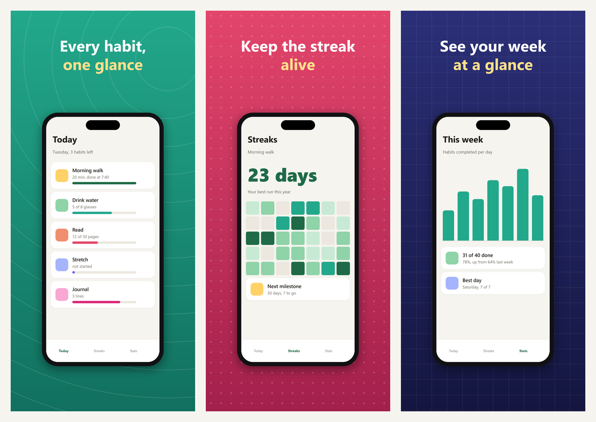
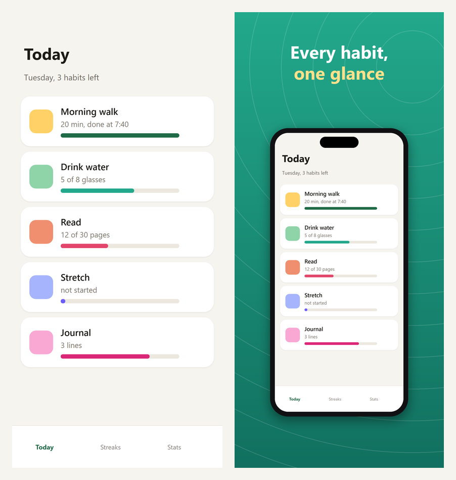
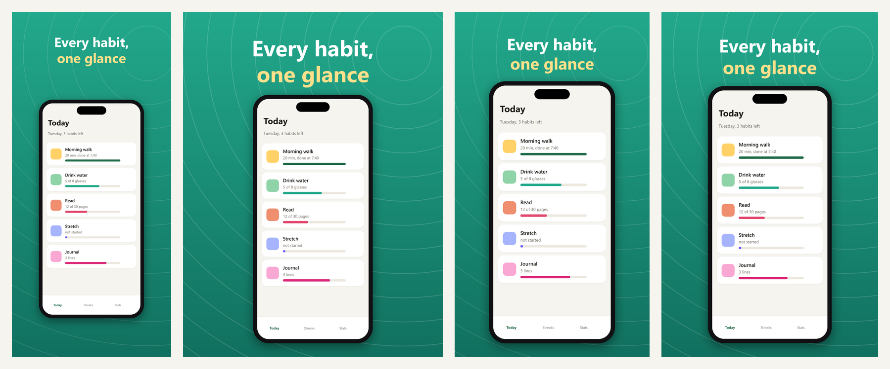
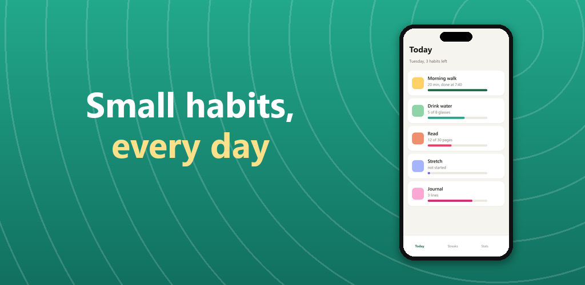

<div align="center">

# storeshots

**Turn raw app screenshots into App Store and Google Play images, every store size at once.**

The agent skills that make store screenshots today ([app-store-screenshot-skill](https://github.com/zaferayan/app-store-screenshot-skill), [Store Screenshot Studio](https://github.com/7ANV1R/Store-Screenshot-Studio)) need Chrome or Node. This is one Python file with Pillow.

Works with **Claude Code** and **Codex**.

 



<sub>Real output of <code>python storeshots.py --demo</code>. The app screens are headless-browser screenshots of the small sample app in <code>examples/raw/</code>.</sub>

</div>

## Quick start
```bash
git clone https://github.com/Dodai0419/storeshots && cd storeshots && pip install pillow
python storeshots.py --demo
```
```
.../examples/stores/iphone-6.9in_1320x2868/01-today.png  1320x2868 RGB
.../examples/stores/ipad-13in_2048x2732/01-today.png  2048x2732 RGB
.../examples/stores/android-phone_1080x1920/01-today.png  1080x1920 RGB
.../examples/stores/android-tab-7in_1200x1920/01-today.png  1200x1920 RGB
.../examples/stores/feature-graphic_1024x500.png  1024x500 RGB
```
For your own app: `python storeshots.py my-app/set.json --stores all --feature`.

## The problem
- Store screenshot tools are templates in a browser: you install Chrome or Node, then export each size by hand.
- Apple wants 1320x2868 and 2048x2732, Google wants at most a 2:1 ratio and no alpha channel. One wrong export gets rejected.
- "#1 habit app" and "Best price" look fine to you and get the listing rejected.

## The solution
| Idea | Fixes |
|------|-------|
| **One `set.json`, every store size** (iPhone 6.9", iPad 13", Android phone, Android 7" tablet) **plus the 1024x500 feature graphic** | exporting five sizes by hand |
| **The screenshot is only resized, never redrawn**; the whole phone always fits, so no UI is cropped (tested pixel by pixel) | a frame that hides the button you wanted to show |
| **Flat RGB PNG at the exact size**, Play's 2:1 and 320-3840 px limits checked | "image contains transparency" rejections |
| **Store-safe copy check**: `#1`, "best", "free", prices, "guaranteed"... warned, `--strict` fails | a rejected listing |
| **Same `set.json` as app-store-screenshot-skill**, so an agent that knows that format already knows this one | learning another schema |

## Before and after


## One design, every store size


| Folder | Size | Store slot |
|---|---|---|
| `iphone-6.9in_1320x2868/` | 1320 x 2868 | App Store iPhone 6.9" (Apple scales it down for smaller iPhones) |
| `ipad-13in_2048x2732/` | 2048 x 2732 | App Store iPad 13" |
| `android-phone_1080x1920/` | 1080 x 1920 | Google Play phone |
| `android-tab-7in_1200x1920/` | 1200 x 1920 | Google Play 7" tablet |
| `feature-graphic_1024x500.png` | 1024 x 500 | Google Play feature graphic |

## Google Play feature graphic


## set.json
```json
{
  "size": "1290x2796",
  "out_dir": "stores",
  "theme": {"text": "#ffffff", "accent2": "#ffe08a", "device_max_w": 0.66, "platform": "ios", "frame": "black"},
  "feature": {"headline": "Small habits,\n*every day*"},
  "images": [
    {"screenshot": "raw/home.png", "out": "01-today.png",
     "headline": "Every habit,\n*one glance*", "bg": "#22a88b", "bg2": "#11705f", "pattern": "rings"},
    {"screenshot": "raw/streaks.png", "out": "02-streaks.png",
     "headline": "Keep the streak\n*alive*", "bg": "#e3456b", "bg2": "#a3204c", "pattern": "dots"}
  ]
}
```
- `\n` breaks a line, `*text*` gets the accent colour (`accent2`, else `accent`).
- Theme keys, also settable per image: `bg`, `bg2` (gradient), `accent`, `accent2`, `text` (auto black/white from `bg` when unset), `platform` (`ios` dynamic island / `android` punch hole), `frame` (`black`, `white`, `silver`, `gold` or any colour), `cutout`, `device_max_w`, `headline_lines`, `pattern` (`rings`, `dots`, `grid`, `rays`, `none`).
- `sub` on an image adds a one-line subheadline. `feature` sets the feature graphic's headline and screenshot.
- Paths are relative to `set.json`. app-store-screenshot-skill's HTML-only keys (`scene`, `font_links`, ...) are ignored.

## Usage
```bash
python storeshots.py set.json                       # the "size" in set.json only
python storeshots.py set.json --stores all          # every store size
python storeshots.py set.json --stores ios          # iPhone 6.9" + iPad 13"
python storeshots.py set.json --stores play --feature
python storeshots.py set.json --stores android-phone,iphone-6.9in --out build/
python storeshots.py set.json --strict              # exit 1 on risky claims
```

## Use with Claude Code
```bash
/plugin marketplace add Dodai0419/storeshots
/plugin install storeshots@storeshots
```
Then: *"Make App Store and Play screenshots from the PNGs in ./screens."*

## Use with Codex (ChatGPT)
```bash
git clone https://github.com/Dodai0419/storeshots && cp -r storeshots/skills/* ~/.codex/skills/
```
Or copy `AGENTS.md` into your project root.

## Benchmarks
| | app-store-screenshot-skill | Store Screenshot Studio | storeshots |
|-|-|-|-|
| renderer | headless Chrome per image (`render.mjs` + `template.html`) | Node 20 + Chrome + a renderer downloaded on first run | Pillow |
| lines of code | 447 (`render.mjs` 269 + `template.html` 178) | 1,629 (all `.mjs/.js/.css/.html` under `skills/`) | **210** (one file) |
| needs internet | no | once (renderer download) | no |
| 3 screens x 4 store sizes + feature graphic (13 PNGs) | not measured | not measured | 6.2-12.4 s (6 runs, ~0.5-1 s per image) |

Reproduce with `python bench/bench.py` (3 runs of `storeshots.render('examples/set.json', all sizes, feature=True)`, timed with `time.perf_counter`). Measured twice on Windows 11, Python 3.11.1, Pillow 12.3, with the CPU busy (~99% load from other jobs), so the range is wide; an idle machine lands at the low end. Lines counted with `wc -l`. The two upstream renderers were not run on this machine, so their speed is "not measured".

## Known limits
- No 3D phone, props or photo backgrounds (Store Screenshot Studio has them); backgrounds are gradients plus a pattern.
- The headline font is the first bold sans it finds (Segoe UI, Arial, DejaVu Sans, Helvetica), so it differs per OS.
- No localisation yet: one `set.json` per language.

## Inspired by
- [zaferayan/app-store-screenshot-skill](https://github.com/zaferayan/app-store-screenshot-skill) — the `set.json` format, headline markup and store-size notes (MIT).
- [7ANV1R/Store-Screenshot-Studio](https://github.com/7ANV1R/Store-Screenshot-Studio) — the every-size export table, the feature graphic and the store-safe copy rules (MIT).

## Roadmap
- [ ] Photo / image backgrounds with a scrim
- [ ] `--langs` to render one set per language from a strings file
- [ ] Landscape (iPad / tablet) layouts

## License
MIT. See `LICENSE` for the upstream copyright notices.
